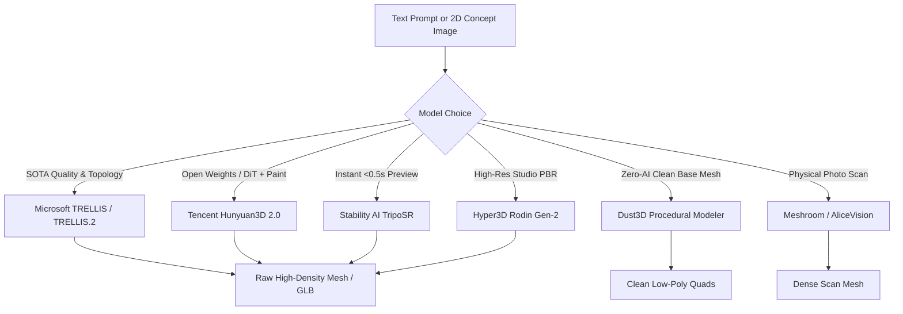
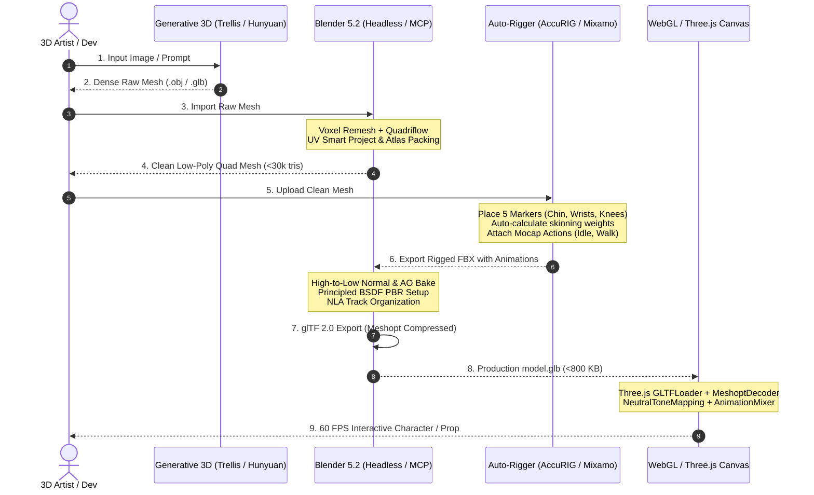

# Blender 5.2 & 3D Pipeline Architect: Master Audit & State-of-the-Art Guide

---

## Executive Summary

This reference document synthesizes an architectural audit of the local **Blender 5.2.2 LTS** environment, inspects its active AI agent integrations (including `MCP for Blender`), analyzes battle-tested headless pipelines across production projects (`SunChips`, `particle-specimens`), documents the current state-of-the-art free generative 3D and auto-rigging toolsets, and establishes an end-to-end production pipeline from prompt to interactive WebGL/Three.js.

---

## Part 1: Local Blender 5.2 & 3D Pipeline Audit

### 1.1 Local Installation & Environment Profile

| Component | Path / Specification | Verified Status |
| :--- | :--- | :--- |
| **Blender Executable** | `C:\Program Files\Blender Foundation\Blender 5.2\blender.exe` | **Blender 5.2.2 LTS** (Build hash `d13f752e3b9c`, 2026-09-15) |
| **Python Runtime** | Embedded Python 3.13 (`python313.dll`, `python3.dll`) | Functional |
| **AppData Roaming** | `C:\Users\USER-PC\AppData\Roaming\Blender Foundation\Blender\5.2` | Config, scripts, and extensions verified |
| **GPU / Acceleration** | **NVIDIA GeForce RTX 5070 Ti** | **Cycles OptiX (`OPTIX`) Enabled & Functional**; CUDA / OneAPI ready |
| **Host CPU** | AMD Ryzen 7 7800X3D (8 Cores, 16 Threads @ 4.2GHz) | High-performance multi-threading verified |
| **Launch Tools** | `blender-launcher.exe`, `blender_factory_startup.cmd`, `blender_startup_vulkan.cmd` | Available in installation directory |

#### Cycles Device Verification (Live Query Output)
Running `prefs.compute_device_type = 'OPTIX'` in Blender headless mode verified the active hardware compute device list:
```python
CYCLES DEVICES: [
    ('NVIDIA GeForce RTX 5070 Ti', 'OPTIX', True),    # PRIMARY ACTIVE GPU ACCELERATOR
    ('NVIDIA GeForce RTX 5070 Ti', 'CUDA', False),
    ('AMD Ryzen 7 7800X3D 8-Core Processor', 'CPU', False),
    ('AMD Radeon(TM) Graphics', 'HIP', False)
]
```

---

### 1.2 Installed Add-Ons & Scripts Analysis

Auditing the active addon registry in Blender 5.2 identified the following modules:

```python
ACTIVE ADDONS: [
    'blender_mcp',       # MCP for Blender (AI Agent Bridge)
    'cycles',            # GPU Pathtracing Renderer (OptiX backend)
    'io_scene_gltf2',    # Khronos glTF 2.0 importer / exporter
    'io_scene_fbx',      # Autodesk FBX importer / exporter
    'io_anim_bvh',       # BioVision Mocap importer / exporter
    'io_mesh_uv_layout', # UV export utilities
    'io_curve_svg',      # Scalable Vector Graphics curve importer
    'pose_library',      # Character pose library
    'bl_pkg'             # Blender extensions package manager
]
```

#### The `blender_mcp` Add-On Architecture
- **Location:** `C:\Users\USER-PC\AppData\Roaming\Blender Foundation\Blender\5.2\scripts\addons\blender_mcp.py` (5,344 lines, v1.7, Protocol v9 by Siddharth Ahuja).
- **Network Interface:** Starts a non-blocking TCP socket server on `localhost:9876` (`bpy.types.Scene.blendermcp_port`).
- **Concurrency & Main-Thread Safety:** Incoming socket requests from AI agents run on independent background threads. To avoid crashes and memory corruption with Blender's single-threaded `bpy` core, commands are enqueued into a thread-safe `queue.Queue` (`self.command_queue`) and drained synchronously inside Blender's main runloop via `bpy.app.timers.register`.
- **Supported Capabilities:**
  - **Inspection:** `get_scene_info`, `get_world_state_snapshot`, `get_addon_info`, `get_object_info`, `describe_node_type`, `bpy_api_lookup`.
  - **Visual Feedback:** `get_viewport_screenshot` (renders an instant viewport pass and returns a base64-encoded PNG directly to the LLM agent).
  - **Remote Execution:** `execute_code` (executes arbitrary Python strings with redirected `stdout` and error tracebacks).
  - **Exporting:** `export_scene` (automated glTF/GLB, FBX, OBJ).
  - **External Cloud Integrations Wired In-Code:**
    - **Poly Haven:** Automated texture/HDRI browsing and Principled BSDF node network construction.
    - **Hyper3D / Rodin Gen-2:** `create_rodin_job`, `poll_rodin_job_status`, `import_generated_asset` (configured with trial key `"vibecoding"`).
    - **Hunyuan3D:** `create_hunyuan_job`, `poll_hunyuan_job_status`, `import_generated_asset_hunyuan`.
    - **Sketchfab & Poly Pizza:** In-scene asset searching and import.

#### How AI Agents (Claude, Copilot, Gemini) Connect to Blender
AI agents connect using the Model Context Protocol (MCP) client bridge:
```
+-------------------------------------------------------+
|  AI Agent (Claude Desktop, Antigravity, Cursor, Roo)  |
+-------------------------------------------------------+
                           |
                     (stdio JSON-RPC)
                           v
+-------------------------------------------------------+
|  MCP Client Bridge (uvx mcp-for-blender / node-bridge)|
+-------------------------------------------------------+
                           |
                 (TCP Socket: localhost:9876)
                           v
+-------------------------------------------------------+
|  Blender 5.2 In-Process Server (blender_mcp.py)      |
|  - Main Thread Command Queue                          |
|  - bpy Python Execution Context                       |
+-------------------------------------------------------+
```

To configure in `mcp_config.json` or `claude_desktop_config.json`:
```json
{
  "mcpServers": {
    "blender": {
      "command": "uvx",
      "args": ["mcp-for-blender"]
    }
  }
}
```

---

### 1.3 Programmatic Headless Blender Usage in User Projects

An audit of existing user repositories (`SunChips` in `C:\Users\USER-PC\.gemini\antigravity\scratch\SunChips` and `particle-specimens`) reveals an extraordinarily rigorous, production-grade 3D pipeline standard:

#### 1. Parametric Modeling & Deformation Preserving Surface Area
In `tools/blender/build_bag.py` and `pillow-pack.py`:
- Mesh is constructed using `bmesh` with parameterized analytical equations (sine/exponential puff functions, side fin seams, and pinked cut teeth).
- **Opening Morph (Shape Keys):** Rather than standard linear translation (which stretches and distorts UV printed artwork), lips hinge along circular arcs calculated via cumulative segment integration (`math.hypot`, arc angles), keeping edge lengths invariant:
  $$\text{length}(L) = \sum \sqrt{\Delta y^2 + \Delta z^2} \approx \text{const}$$

#### 2. Headless Invocations Standard
All builds are run strictly in headless mode to guarantee determinism and avoid disturbing GUI states:
```powershell
& "C:\Program Files\Blender Foundation\Blender 5.2\blender.exe" -b --factory-startup --python-exit-code 1 -P .\tools\blender\build_bag.py -- --exposure -1.0 --samples 96 --promote
```

#### 3. Exact Khronos PBR Neutral Tone Mapping Parity
To guarantee a **1-pixel, seamless registration handoff** between pre-rendered fallback stills and live Three.js canvas WebGL models:
1. Renders scene in Cycles to a 32-bit linear OpenEXR (`scene.render.image_settings.file_format = "OPEN_EXR"`).
2. Unpremultiplies RGB where $\alpha > 10^{-6}$.
3. Scales exposure by $2^{\text{EV}}$ (e.g. $-1\text{ EV} = 0.5\times$ to prevent yellow channel clipping).
4. Applies the exact **Khronos PBR Neutral reference algorithm** via NumPy:
   ```python
   def pbr_neutral(c):
       minimum = c.min(axis=-1, keepdims=True)
       c = c - np.where(minimum < 0.08, minimum - 6.25 * minimum * minimum, 0.04)
       peak = c.max(axis=-1, keepdims=True)
       start, d = 0.76, 0.24
       safe_peak = np.maximum(peak, start)
       new_peak = 1 - d * d / (safe_peak + d - start)
       mix = 1 - 1 / (0.15 * (safe_peak - new_peak) + 1)
       mapped = c * new_peak / safe_peak * (1 - mix) + new_peak * mix
       return np.where(peak < start, c, mapped)
   ```
5. Applies Triangular Probability Density Function (TPDF) dither of 1 LSB peak-to-peak before quantizing to 8-bit sRGB PNG.

#### 4. Shared Studio Lighting & Distance Invariance
Lights defined in `studio.json` are scaled by $k=100$:
$$\text{Position} \times k, \quad \text{Size} \times k, \quad \text{Power} \times k^2$$
This maintains constant solid angle and radiance while eliminating parallax differences across the model between the offline raytracer and the web environment baker.

#### 5. GLB Binary Chunk Verification & Meshopt Compression
User scripts inspect the binary glTF stream (`b"glTF"`, JSON chunk header, target names) to guarantee that named shape keys (`open`) are preserved before release, followed by glTF-Transform Meshopt compression:
```powershell
npx --no-install gltf-transform meshopt .\artifacts\product-raw.glb .\public\3d\product.glb
```

#### 6. Surface Point Cloud Sampling (`particle-specimens`)
In `particle-specimens`, 12 procedural specimens (HAL eye, DNA, gears, temple) are generated headlessly, normalized to a unit bounding sphere ($r=1.0$), and exported as a unified compressed GLB. In Three.js, `MeshSurfaceSampler` extracts surface positions into GPU vertex buffers for real-time vertex shader morphing with curl noise and mouse physics.

---

## Part 2: State-of-the-Art Free 3D Creation & Auto-Rigging Tools

### 2.1 Generative 3D Creation Tools (AI & Procedural)



| Tool | Developer / License | Strengths | Best Used For | Outputs |
| :--- | :--- | :--- | :--- | :--- |
| **TRELLIS & TRELLIS.2** | Microsoft / MIT & Open Weights | Structured 3D Latents (SLAT), O-Voxel (4B params). Handles open surfaces, thin clothing, non-manifold geometry, native PBR (Albedo, Roughness, Metallic, Opacity). | Production hero props, stylized characters, intricate hard-surface objects. | GLB, 3D Gaussians (PLY), NeRF |
| **Hunyuan3D 2.0** | Tencent / Open Source | Dual-stage pipeline: Hunyuan3D-DiT (geometry synthesis) + Hunyuan3D-Paint (texture projection). Available locally or on HuggingFace. Built directly into local `blender_mcp.py`! | Character concept meshes, organic props, fantasy assets with detailed albedo. | OBJ, GLB with textures |
| **TripoSR** | Stability AI + Tripo / MIT | Ultra-fast feed-forward Large Reconstruction Model (<0.5s on RTX 5070 Ti). Runs completely offline. | Instant 3D silhouette prototyping, background filler meshes, rapid ideation. | OBJ, GLB |
| **Hyper3D Rodin Gen-2** | Deemos / Freemium (`vibecoding` key) | Industry-leading facial likeness, anatomical fidelity, multi-material PBR separation. Integrated into local `blender_mcp`. | Digital human avatars, hero characters, detailed cloth drapery. | GLB with full PBR texture sets |
| **InstantMesh / LGM** | Tencent ARC / Apache 2.0 | Multi-view diffusion + Sparse NeuS. Fast reconstruction (~10s) with clean watertight surfaces. | Rapid conversion of Midjourney/Stable Diffusion 2D character turnarounds into 3D. | OBJ, PLY |
| **Dust3D** | Open Source (GPLv3) | Non-AI procedural node/sketch modeler. Instant automatic UV unwrapping, watertight quad topology, zero hallucination. | Game-ready base meshes, indie character mannequins, mechanical blockouts. | OBJ, FBX, glTF |
| **Meshroom / AliceVision** | AliceVision / Open Source (MPLv2) | High-end nodal photogrammetry pipeline. Features feature extraction, dense point cloud matching, depth mapping, and texture baking. | Real-world physical products, packaging, shoes, environmental assets. | OBJ with baked 4K/8K texture atlases |

---

### 2.2 Free 3D Auto-Rigging & Animation Tools

| Tool | Cost / Access | Skeleton Type | Animation Capabilities | Best Pairing |
| :--- | :--- | :--- | :--- | :--- |
| **ActorCore AccuRIG** (Reallusion) | **100% Free** Desktop (Windows) | Standard Humanoid (Body + 5-finger hands) | Automatic joint placement (5 body + 5 finger points), automatic high-quality skinning weights. Exports clean FBX with Unreal/Unity/Blender hierarchy. | Best for rigging complex humanoid meshes without manual weight painting. |
| **Adobe Mixamo** | **100% Free** Web-based | Standard Humanoid (16/65 bones) | 2-minute 5-point marker placement (chin, wrists, elbows, knees, groin). Instant library of **10,000+ free mocap clips** (idle, run, combat, dance) with in-place looping options. | Rapid web/game prototyping, background crowds, ready-to-use locomotion cycles. |
| **Cascadeur (Free Tier)** | Free Indie License | Humanoid & Non-Humanoid / Animals | AI AutoPosing, neural trajectory completion, secondary motion physics, Quick Rigging tool. | Physics-based custom animation, acrobatic flips, realistic balance correction. |
| **Blender Rigify** | **Built-in Addon** (Free) | Modular (Human, Quadruped, Bird, Cat) | Generates full professional production control rig with IK/FK switching, bendy bones, facial control widgets, and custom UI script. | Full studio character animation directly inside Blender. |
| **Auto-Rig Pro Patterns** | Add-on Pattern | Game Engine Deformation Rig | Separates deformation bones from control bones, preventing rig bloat during glTF web export. Automated mocap retargeting. | Production Three.js/WebGL avatars requiring small download payloads. |
| **Rokoko Studio** | Free (AI Video Mocap) | Humanoid Skeleton | Extracts full body animation from single smartphone/webcam video. Free Blender addon for 1-click retargeting to Rigify. | Custom bespoke acting, conversational gestures, custom dance moves without mocap suits. |

---

## Part 3: The Complete Production Pipeline Guide

### End-to-End Workflow Architecture



---

### Step 1: Generative 3D Mesh Creation
Using **TRELLIS.2** or **Hunyuan3D 2.0** (or directly via `blender_mcp.py`):
- Generate the raw 3D mesh from an orthogonal or 3/4 front image.
- Ensure the character or object is generated in a clean **T-pose** or **A-pose** with feet flat on the ground plane ($Z=0$).
- Export as raw `raw_asset.glb` or `raw_asset.obj`.

---

### Step 2: Clean Mesh & Automatic Retopology in Blender

Generative AI meshes typically contain between 200,000 and 1,000,000 messy triangles, with non-manifold edges and irregular topology. We retopologize down to 10,000–30,000 quads for web performance:

```python
# Save as retopo_pipeline.py
import bpy

def retopologize(obj, target_faces=15000):
    bpy.context.view_layer.objects.active = obj
    obj.select_set(True)

    # 1. Close holes and make manifold via Voxel Remesh
    bpy.ops.object.mode_set(mode='OBJECT')
    obj.data.remesh_voxel_size = 0.008  # Tune to model scale
    obj.data.remesh_voxel_adaptivity = 0.0
    bpy.ops.object.voxel_remesh()

    # 2. Quadriflow Remesh to clean quad topology
    bpy.ops.object.quadriflow_remesh(
        use_mesh_symmetry=True,
        use_preserve_sharp=True,
        use_preserve_boundary=True,
        mode='FACES',
        target_faces=target_faces
    )

    # 3. Clean automated UV Unwrapping
    bpy.ops.object.mode_set(mode='EDIT')
    bpy.ops.mesh.select_all(action='SELECT')
    bpy.ops.uv.smart_project(
        angle_limit=66.0,
        island_margin=0.015,
        area_weight=0.0,
        correct_aspect=True,
        scale_to_bounds=False
    )
    bpy.ops.object.mode_set(mode='OBJECT')
    print(f"Retopology complete: {len(obj.data.polygons)} quads.")

if __name__ == "__main__":
    obj = bpy.context.active_object
    retopologize(obj)
```

Run headlessly:
```powershell
& "C:\Program Files\Blender Foundation\Blender 5.2\blender.exe" -b input_scene.blend -P retopo_pipeline.py -o clean_mesh.blend -f 1
```

---

### Step 3: Auto-Rigging & Animation Baking

1. **Export the clean mesh** as FBX:
   ```python
   bpy.ops.export_scene.fbx(filepath="character_clean.fbx", use_selection=True, mesh_smooth_type='FACE')
   ```
2. **AccuRIG / Mixamo Processing:**
   - Upload `character_clean.fbx` to **ActorCore AccuRIG** (offline) or **Adobe Mixamo** (online).
   - Place anatomical markers: Chin, Wrists, Elbows, Knees, Groin.
   - AccuRIG automatically computes volumetric heat-map skin weights and adds 5-finger digit bones.
   - In Mixamo, download:
     - **T-Pose Rig:** `character_rigged.fbx` ("Without Skin" or "With Skin").
     - **Animation Clips:** `Idle.fbx`, `Walk.fbx`, `Interact.fbx` (Export format: *FBX for Unity / Blender*, 30 or 60 fps, check *In Place* for locomotion).

---

### Step 4: Animation Assembly & PBR Texture Baking in Blender

Import the rigged character and animations into Blender 5.2:

```python
# Save as assemble_rig_and_bake.py
import bpy

def setup_character_actions():
    # 1. Import character base
    bpy.ops.import_scene.fbx(filepath="character_rigged.fbx")
    armature = [o for o in bpy.context.selected_objects if o.type == 'ARMATURE'][0]
    
    # 2. Import animations into NLA tracks
    for clip_name, file_path in [("Idle", "Idle.fbx"), ("Walk", "Walk.fbx")]:
        bpy.ops.import_scene.fbx(filepath=file_path)
        anim_armature = [o for o in bpy.context.selected_objects if o.type == 'ARMATURE'][0]
        action = anim_armature.animation_data.action
        action.name = clip_name
        
        # Stash action onto main armature's NLA
        track = armature.animation_data.nla_tracks.new()
        track.name = clip_name
        track.strips.new(clip_name, int(action.frame_range[0]), action)
        
        # Cleanup temporary anim armature
        bpy.data.objects.remove(anim_armature, do_unlink=True)

    print("Rig and NLA actions successfully assembled.")

if __name__ == "__main__":
    setup_character_actions()
```

#### High-to-Low Normal & AO Baking (Cycles GPU OptiX):
1. Create a 2048×2048 32-bit Float image texture (`character_normal.png`).
2. Add a `ShaderNodeTexImage` to the low-poly material (keep selected, unlinked).
3. Select high-poly mesh, Shift-select low-poly mesh.
4. Set Cycles render settings:
   ```python
   scene.render.engine = 'CYCLES'
   scene.cycles.device = 'GPU'
   bpy.context.preferences.addons['cycles'].preferences.compute_device_type = 'OPTIX'
   bpy.ops.object.bake(type='NORMAL', selected_to_active=True, cage_extrusion=0.015)
   ```

---

### Step 5: Web-Optimized glTF/GLB Export

Export using Blender 5.2's native glTF 2.0 exporter, ensuring deformation animations and textures are packaged cleanly:

```python
bpy.ops.export_scene.gltf(
    filepath="public/3d/character.glb",
    export_format='GLB',
    use_selection=False,
    export_apply=False,           # CRITICAL: False so bone skinning & armatures are preserved!
    export_animations=True,
    export_nla_strips=True,       # Exports all stashed clips (Idle, Walk) into separate glTF animations
    export_def_bones=True,        # Only exports deformation bones, stripping IK control helpers
    export_morph=True,
    export_morph_normal=True,
    export_materials='EXPORT',
    export_image_format='AUTO',
    export_colors=False
)
```

#### Post-Processing with glTF-Transform (Meshopt + WebP / KTX2):
Compress geometry and textures for ultra-low mobile bandwidth:
```powershell
npx --no-install gltf-transform meshopt public/3d/character.glb public/3d/character.min.glb
```
*Result:* Typically reduces file size from 15 MB down to **400–900 KB** with lossless vertex decompression.

---

### Step 6: Interactive WebGL / Three.js Implementation

The complete production-ready Three.js integration module:

```typescript
// character-stage.ts
import * as THREE from 'three';
import { GLTFLoader } from 'three/examples/jsm/loaders/GLTFLoader.js';
import { MeshoptDecoder } from 'three/examples/jsm/libs/meshopt_decoder.module.js';
import { OrbitControls } from 'three/examples/jsm/controls/OrbitControls.js';

export class CharacterStage {
  private scene: THREE.Scene;
  private camera: THREE.PerspectiveCamera;
  private renderer: THREE.WebGLRenderer;
  private mixer: THREE.AnimationMixer | null = null;
  private actions: Map<string, THREE.AnimationAction> = new Map();
  private clock = new THREE.Clock();

  constructor(canvas: HTMLCanvasElement) {
    // 1. Scene & Camera
    this.scene = new THREE.Scene();
    this.camera = new THREE.PerspectiveCamera(38, canvas.clientWidth / canvas.clientHeight, 0.1, 100);
    this.camera.position.set(0, 1.2, 3.2);

    // 2. Renderer with Khronos PBR Neutral Tone Mapping (Exact Blender Cycles Parity)
    this.renderer = new THREE.WebGLRenderer({ canvas, antialias: true, alpha: true });
    this.renderer.setSize(canvas.clientWidth, canvas.clientHeight, false);
    this.renderer.setPixelRatio(Math.min(window.devicePixelRatio, 2.0));
    this.renderer.toneMapping = THREE.NeutralToneMapping;
    this.renderer.toneMappingExposure = 1.0;
    this.renderer.shadowMap.enabled = true;
    this.renderer.shadowMap.type = THREE.PCFSoftShadowMap;

    // 3. Studio Lighting Rig
    this.setupLights();

    // 4. Load Model
    this.loadModel('3d/character.min.glb');

    // 5. Controls & Resize
    new OrbitControls(this.camera, canvas);
    window.addEventListener('resize', () => this.onResize(canvas));
    this.animate();
  }

  private setupLights() {
    const ambient = new THREE.AmbientLight(0xffffff, 0.4);
    this.scene.add(ambient);

    const keyLight = new THREE.DirectionalLight(0xfff5ea, 2.2);
    keyLight.position.set(-1.5, 3.0, 2.0);
    keyLight.castShadow = true;
    keyLight.shadow.mapSize.set(1024, 1024);
    keyLight.shadow.bias = -0.0001;
    this.scene.add(keyLight);

    const rimLight = new THREE.DirectionalLight(0xcce3ff, 1.5);
    rimLight.position.set(1.5, 2.0, -2.5);
    this.scene.add(rimLight);
  }

  private loadModel(url: string) {
    const loader = new GLTFLoader();
    loader.setMeshoptDecoder(MeshoptDecoder);

    loader.load(url, (gltf) => {
      const model = gltf.scene;
      model.traverse((child) => {
        if ((child as THREE.Mesh).isMesh) {
          child.castShadow = true;
          child.receiveShadow = true;
        }
      });

      this.scene.add(model);

      // Animation Setup
      if (gltf.animations.length > 0) {
        this.mixer = new THREE.AnimationMixer(model);
        gltf.animations.forEach((clip) => {
          const action = this.mixer!.clipAction(clip);
          this.actions.set(clip.name, action);
        });

        // Default to Idle animation
        const idleAction = this.actions.get('Idle') || gltf.animations[0];
        if (idleAction) {
          this.actions.get(idleAction.name)?.play();
        }
      }
    });
  }

  public crossFadeTo(name: string, duration = 0.4) {
    const target = this.actions.get(name);
    if (!target) return;

    this.actions.forEach((action) => {
      if (action !== target && action.isRunning()) {
        action.fadeOut(duration);
      }
    });

    target.reset().fadeIn(duration).play();
  }

  private onResize(canvas: HTMLCanvasElement) {
    this.camera.aspect = canvas.clientWidth / canvas.clientHeight;
    this.camera.updateProjectionMatrix();
    this.renderer.setSize(canvas.clientWidth, canvas.clientHeight, false);
  }

  private animate = () => {
    requestAnimationFrame(this.animate);
    const delta = this.clock.getDelta();
    if (this.mixer) this.mixer.update(delta);
    this.renderer.render(this.scene, this.camera);
  };
}
```

---

## Part 4: Architectural Checklist & Quality Gates

Before declaring any 3D asset web-ready, verify against these non-negotiable gates:

- [ ] **Deterministic Scale & Orientation:** Metric units ($1.0 = 1\text{ m}$), $Y\text{-up}$ glTF standard, pivot point centered at base ($Z=0$).
- [ ] **Topology Budget:** Max 30,000 triangles for animated characters; max 10,000 triangles for static props.
- [ ] **PBR Neutral Color Registration:** Tested with `THREE.NeutralToneMapping` matching Blender linear EXR renders within $\le 4/255$ color channel levels.
- [ ] **Payload Ceiling:** Exported, Meshopt-compressed GLB $\le 1.2\text{ MB}$ total transfer size including textures and all animation tracks.
- [ ] **Draw Calls:** Merged texture atlases ensuring no more than 1–2 draw calls per character model.
- [ ] **Deformation Rig Hygiene:** Export only deformation bones (`export_def_bones=True`); zero IK helper pole targets in glTF scene graph.
